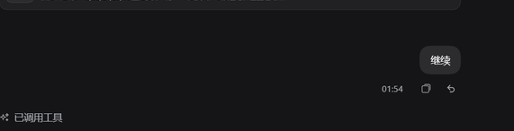
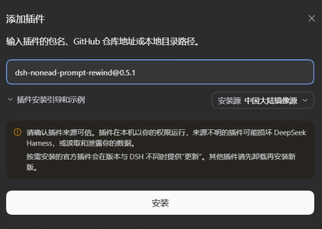
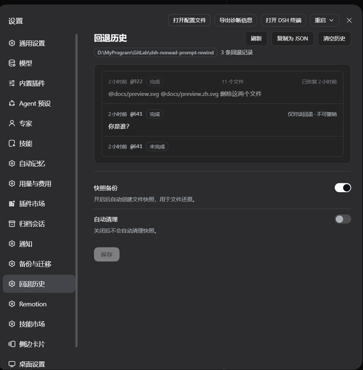

# dsh-nonead-prompt-rewind

Conversation rewind for DeepSeek Harness: **rewind the conversation to any earlier user message in one click, in the same window**.<br />
No new branch, no window switch, with optional workspace-file restore — the full Claude Code `/rewind` semantics.

English | [中文](README.md)

[](https://www.npmjs.com/package/dsh-nonead-prompt-rewind)
[](https://www.npmjs.com/package/dsh-nonead-prompt-rewind)
[](LICENSE)

A deliberately focused plugin with one job: **rewind to any user message, no matter how far back, in place** — and conveniently **restore the files it changed** along the way.

- **In-place rewind, no new session** — the target message and everything after it (replies, tool calls) are withdrawn from the model context *and* the rendered transcript, and the target's text is filled back into the composer for editing and re-sending. It all happens inside the original session: no new branch, no leftover copy.
- **Lightweight checkpoint restore** — Claude Code-aligned: files edited by the write tools are tracked and restored by the same rewind, and external changes to already-tracked files are restorable too. **Partial tracking, before-write backup, store only on change**, with no git dependency.
- **Safety guarantees** — the session log only ever appends rewind markers and is never deleted or rewritten; file backup and restore are hardened; tests cover the conversation, snapshot, history, and client paths. Security model: [SECURITY.md](SECURITY.md).

## Preview

Every user message carries a **↶ rewind** button in its action row. Clicking it opens a single confirmation dialog listing the files that will be restored or deleted; one confirm rewinds **the conversation and the files together** — there is no mode choice and no half rewind. The target's text is filled back into the composer. You can also pick the target with the **`/rewind` and `/undo` commands**, or name it directly with `/rewind @<seq>`.



### Rewind history and undo

Settings → **Rewind history** lists the last 10 rewinds for the **current workspace** (each workspace is separate and cannot see another's), with each outcome marked as Done / Partial / Failed.

- **Restore to before this rewind** — only the newest not-yet-undone rewind **of the current session** can be restored, and it restores **files only, never the conversation**; each entry can be undone once.
- **Your later edits win** — if a file changed after the rewind, the restore is refused rather than overwriting your change.
- **Export or clear** — copy the history as JSON, or clear it in one click; clearing removes records only, not snapshots or conversations.
- The plugin's configuration card sits on the same page and toggles backups and auto-cleanup.

## Install

Check your local DSH version, then find the matching plugin version in
[Releases](https://github.com/NoneadChina/dsh-nonead-prompt-rewind/releases).

**Command line**:

```sh
dsh plugin --profile <name> add dsh-nonead-prompt-rewind@<version>
```

**Graphical interface**: the **Plugins** page in the sidebar → **Add plugin** → enter `dsh-nonead-prompt-rewind@<version>` → install → restart DSH.

<br>
<sub>The screenshot is an example only — use the version that matches your DSH version.</sub>

> [!WARNING]
> The npm name `dsh-rewind` belongs to another author's package — install with `dsh-nonead-prompt-rewind`.
> When upgrading from the old name, the plugin entry id and its settings are **not migrated automatically**; reinstall and reconfigure. The `/rewind` and `/undo` commands, the snapshot directory names, and existing snapshots are unchanged.

## Usage

1. Find the user message you want to rewind to and click its **↶**; or type `/rewind` (alias `/undo`) to open the candidate picker; if you know the target sequence, use `/rewind @<seq>` directly.
2. **Confirm it.** The dialog lists the files to restore or delete; click **Rewind** to confirm once.
3. The rewind takes effect immediately: the conversation returns to how it looked at the target message, and the target message's text is filled back into the composer — edit and re-send.

**Keyboard**: the candidate picker supports ↑↓ to move, Enter to confirm, Esc to cancel; the dialog focuses **Cancel** first, and ⌘/Ctrl+Enter confirms directly.

<details>
<summary><b>Edge notes</b></summary>

- **The withdrawn content is preserved** — it stays in the session log and can be inspected in the **Trajectory** panel; you can also disable the plugin to show it again (display only).
- **The conversation cannot be undone in place; the files can** — Settings → **Rewind history** restores the files of the newest rewind once.
- **Interruptions rewind too** — a `steering` message the model hasn't read yet is also a valid rewind target, and withdrawing it does not interrupt the current run.
- **Rewinding a read message interrupts the running turn** — to ensure the rewind runs safely.
- **Changes made while snapshots were off cannot be restored** — backups are the only source a restore draws from.

</details>

## Interface languages

The plugin follows the DSH interface language and ships copy for **Simplified Chinese, English, 日本語, Español, Français, Deutsch, Русский, and Português (Brasil)**: message buttons, the confirmation dialog, the Settings page, the configuration card, and command output. The plugin-detail preview images exist in Chinese and English only; other languages fall back to the English image. Translations are AI-generated — native-speaker corrections are welcome.

## Snapshot management

**Snapshot backups** are on by default: they power file restore and can be switched off in this plugin's configuration card. When off, no new snapshots are created; file changes made while off cannot be restored. Snapshots (the before-write backups) are stored under `<dsh home>/rewind-snapshots/` (the default is `~/.dsh/rewind-snapshots/`). A single file over 8 MiB is not backed up, and each session keeps its newest 100 message groups. Deleting that directory manually only clears the file backups (chat rewinds are unaffected); the plugin can rebuild it automatically.

**Rewind history** lives under `<dsh home>/rewind-history/`, partitioned per workspace, with the newest 10 entries per workspace (adjustable through the `historyLimit` config field). Deleting it loses the Rewind history page's records only — conversations and snapshots are untouched.

A **snapshot auto-cleanup** (off by default) removes the snapshot directories of long-inactive sessions, leaving the active session and chat log untouched. Configure and review it on the plugin's configuration card (the auto-cleanup switch and the idle-day cutoff), or use the `/snapshot-auto-cleanup` command:

```
/snapshot-auto-cleanup                 show status
/snapshot-auto-cleanup on|off          enable/disable auto-cleanup
/snapshot-auto-cleanup max-age <days>  set the idle cutoff
/snapshot-auto-cleanup run [--apply]   dry-run, or execute with --apply
/snapshot-auto-cleanup run --current [--apply]  dry-run/clear this session's snapshots
```

See: [Snapshot auto-cleanup](docs/snapshot-auto-cleanup.md).



## Uninstall

```sh
# Uninstall the plugin
dsh plugin --profile <name> remove dsh-nonead-prompt-rewind

# To also delete local data
rm -rf <dsh home>/rewind-snapshots
rm -rf <dsh home>/rewind-history
rm <dsh home>/snapshot-cleanup-last-sweep.json
```

The plugin's configuration entries are stored in the current Profile's config
file `cordis.patch.yml`. To clean up completely, delete the corresponding entries
manually.

## What this plugin changes

Compared with the default behavior:

| Dimension | Default behavior | This plugin |
| --- | --- | --- |
| Conversation rewind | Branch into a new conversation | **In-place rewind** — no new session branch, no window switch, no leftover session copies |
| File restore | Manual restore / Git management | **Restored together** — lightweight before-write backups; one confirmation rewinds the conversation and the files, fitting agent workflows |
| Restore dependencies | Often needs a Git repository or a full snapshot engine | **None** — no Git repository and no code project required; works in any directory |
| History and undo | No unified record | **Per-workspace trail** — the last 10 rewinds are listed, and the newest one's file changes can be undone |

## How it works

The whole design rests on two principles, simple but deliberate: **the conversation half "masks, never deletes"**, using DSH's native "hide + replace" mechanism; **the file half "partial tracking, lightweight before-write backup"**, following Claude Code's checkpoint semantics.

### 1. Conversation rewind: a single "mask", not a delete

`append-only` is a hard rule: the session log only grows and is never rewritten — the foundation of auditability and privacy. A rewind never touches history; it makes a single move: append **one "empty message" marker** to the end of the log and use it to "mask + replace" the target message and everything after it, so the model and the UI see only what came before it.

- **One and the same log** — the append happens only in the current session's log: no new session, no new branch, so no residue or copy is left behind;
- **The marker is canonical** — the same "hide + replace" as the official `/compact`: `/compact` compresses a span of history into a summary, while `/rewind` swaps in an "empty message" marker. Because it is canonical, DSH's log replay, compaction, and resume preflight all recognize it and never mistake it for a real message;
- **The replacement is imperceptible** — the model ignores the marker, with no effect (verified empirically). Together with the plugin's UI handling, what you and the model see is exactly how the conversation looked at the target;
- **Content is preserved** — because this is "masking, not deleting", the withdrawn content stays in the log — auditable, traceable, and in principle manually recoverable.

> **Design highlight**: the entire conversation rewind is **a single append**. It's deterministic, auditable, and — because the log was never broken — a "clean" time-travel. Minimal action, complete semantics.

### 2. File restore: lightweight checkpointing, "before-write backup"

The file half follows Claude Code's checkpoint semantics — **partial tracking + before-write backup, plus a re-scan of tracked files at each message**, not a whole-tree snapshot. This trade-off saves space, and it's actually more complete:

- **Before-write backup**: tracks only the write-class tools (`write`, `edit`) — backs up the original content before a write and records/tracks the files it touches; it never backs up the whole workspace, so it's lightweight; **a single file over the default 8 MiB limit is not backed up**.
- **External changes count too**: at every user-message boundary the plugin re-checks all tracked files — external changes such as a command run or a manual edit are recorded as well and restored by a later rewind. "Lightweight" but not "incomplete".
- **Unchanged-not-recorded**: an entry is written only when something changed — at the message-boundary re-check, an unchanged file is never backed up (no record); at before-write time, when the new content matches the path's prior record, only a **link to it** (`ref`) is stored instead of a copy.
- **Accurate restore**: backups are the sole standard, checked against the real disk — **only files that actually differ are touched**. Backups are stored byte for byte, so the restored result matches the backups exactly, with no "ghost impact". There is a limit, though: [File-rewind tracking boundary](docs/compat/tracking-boundary.md).
- **Safety and integrity**: paths are sanitized so nothing ever escapes the backup root; symlinks / hard links are skipped so one restore can't clobber another name of the same file; a per-file failure never aborts the pass; backups and the restore journal are written atomically and kept across restarts, so a half-applied restore after a crash can be continued or rolled back. If the snapshots use a newer store format than the plugin understands, the restore is refused outright and the workspace is left unchanged instead of guessed at.

> **Design highlight**: this checkpoint's light footprint comes from **recording only what was actually touched and really changed** — before-write backup makes it restorable, unchanged-not-recorded and content-as-link drop the repetition; only the files that differ are touched at restore time.

## What it deliberately does NOT do

This plugin deliberately stays lightweight and focused on one thing — "conversation rewind". The following are **out of its scope**:

- **Whole-tree / Git-level snapshots** — only write-class tool edits plus external changes to already-tracked files are backed up; files never touched by a tool are not restored. For a worktree-level full snapshot rollback, use a more specialized snapshot tool (git).
- **Subagent edits** — not tracked, and no rewind inside a subagent session (same as Claude Code): a subagent runs its own session, so its backups could never be restored by a rewind of the parent session, and none are kept for one.
- **Fork / branch rewind** — DSH already provides this ("branch in new chat"); no need to reinvent the wheel.

## Compatibility

- Node.js `>=24.9.0`.
- Supports DSH `>=0.2.1-0 <0.3.1-0` (authoritative: `package.json` `engines.dsh`). Missing host capabilities degrade through runtime probes: the Settings page names what is missing instead of failing silently.
- Compatibility definition, verification method, and version alignment: see [docs/compat/audit.md](docs/compat/audit.md).

> [!WARNING]
> This project and DeepSeek Harness are both in developer preview. Pin exact
> versions in reproducible environments and review the behavior notes above.

## Known issues

1. **Exported logs are complete** — `/export` exports the whole session log (raw JSONL), **withdrawn content included**; this plugin cannot alter exports.
2. **Lightweight file rewind has a cost** — in specific cases not all changes can be rewound (files never touched by a tool, files over the size cap, subagent edits). Consistent with Claude Code. See: [File-rewind tracking boundary](docs/compat/tracking-boundary.md).
3. **Turn navigation keeps rewound turns** — the right-side turn navigation keeps an "unloaded" tick for each rewound turn, and hovering previews the withdrawn content. Only a display difference; no functional impact.
4. **A far rewind may show a blank transcript** — when the target predates the loaded history, the conversation area goes blank; click **Load earlier** to page back until the history appears.

> [!NOTE]
> Browser diagnostics are available; see [Browser diagnostics](docs/compat/diagnostics.md).

## Security

This plugin only appends rewind-marker events to the session log; it never deletes or rewrites logged history. Workspace files are written only during a rewind, in the same pass; backups are stored under `<dsh home>/rewind-snapshots/`; restores draw only from those backups. It never touches your git repository, makes no network requests, and accesses no credentials. For sessions you've left inactive for a long time, a snapshot auto-cleanup (off by default) can remove their snapshot directory in whole, leaving the active session and the chat log untouched. Full security model: [SECURITY.md](SECURITY.md).

## Development

```sh
npm install            # devDeps from the npm registry
npm run check          # one-shot full gate: typecheck + build + test + verify:host + pack --dry-run
npm run typecheck      # tsc on all three surfaces (host + client + client-test)
npm test               # vitest: all unit and compatibility suites
npm run build          # esbuild: lib/index.js (host ESM) + lib/client.js (loader closure) + .d.ts
node scripts/verify-host.mjs   # end-to-end verification of the built artifact
```

`prepack` runs the full build, so `npm pack` / `npm publish` always ship a complete `lib/`. Install from npm or a packed tarball — a git checkout has no built `lib/`.

Maintainers: the module map and harness interface reference live in [docs/harness-reference.md](docs/harness-reference.md); architecture and on-disk formats in [docs/architecture.md](docs/architecture.md) and [docs/format.md](docs/format.md).

Collaboration rules and development red lines: [AGENTS.md](AGENTS.md).

## Release

Run `npm run check` first; the version comes from `package.json`, and the release notes go into CHANGELOG in the format described by [docs/release/notes-template.md](docs/release/notes-template.md):

```sh
npm version patch && git push origin <branch> --tags
```

The npm-side Trusted Publisher (OIDC) setup and the full workflow are documented in [docs/release/release.md](docs/release/release.md). This repository currently ships no `.github/workflows/`; automated releases require adding that workflow and configuring a Trusted Publisher first.

## License

[MIT](LICENSE)
