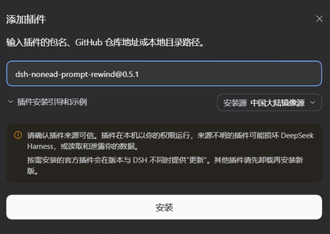
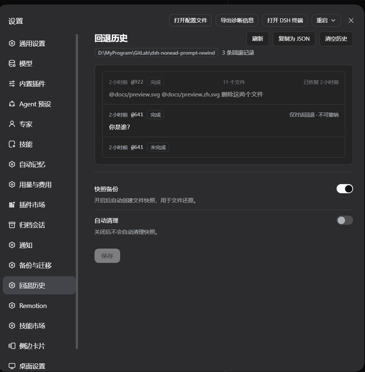

# dsh-nonead-prompt-rewind

DeepSeek Harness 插件：**一键就地回退对话到任意更早的用户消息**。<br />
同窗口内完成，不新建分支、不换窗口，可一并还原工作区文件——即完整的 Claude Code `/rewind` 语义。

[English](README.en.md) | 中文

[](https://www.npmjs.com/package/dsh-nonead-prompt-rewind)
[](https://www.npmjs.com/package/dsh-nonead-prompt-rewind)
[](LICENSE)

刻意聚焦、保持极简，只做一件事：**就地回退到任意远的用户消息**，还能**顺手还原改过的文件**。

- **就地消息回退**——目标消息及其之后的内容同时从**模型上下文**和**渲染对话**中撤回，目标消息文本自动回填输入框。始终在原会话内完成，不新建分支、不残留副本。
- **轻量备份还原**——对齐 Claude Code：追踪写类工具编辑过的文件，回退时一并还原，已跟踪文件的外部变更也能还原。**局部追踪、写前备份、不变不存**，不依赖 git。
- **安全保障**——会话日志仅追加回退标记，从不删改；文件备份与还原经安全加固；测试覆盖对话、快照、历史与客户端交互。安全模型：[SECURITY.md](SECURITY.md)。

## 效果预览

每条用户消息的操作行都有一个 **↶ 回退** 按钮。点击后弹出一次确认框：先列出将被还原 / 删除的文件清单，确认后**对话与文件同时回退**——没有模式选择，也不会只退一半。目标消息的文本自动回填输入框。也可以用 **`/rewind` 和 `/undo` 命令**选择目标，或用 `/rewind @<序号>` 直接指定。


### 回退历史与撤销

设置 →「回退历史」按**工作区**列出最近 10 次回退（每区独立、跨区不可见），并标注每次的结果：完成 / 部分完成 / 未完成。

- **恢复到回退之前**——只有当前会话里最新、尚未撤销的那一条可以恢复，且**只还原文件、不恢复对话**；每条只能撤一次。
- **不覆盖手改**——如果回退之后又改过其中某个文件，撤销会被拒绝，而不是覆盖你的改动。
- **可导出、可清空**——历史可「复制为 JSON」，也可一键清空；清空只删记录，不动快照与对话。
- 同一页下方是本插件的配置卡，可开关备份与自动清理。

## 安装

确认本机 DSH 版本后，在 [Releases](https://github.com/NoneadChina/dsh-nonead-prompt-rewind/releases) 找到适配的插件版本。

**命令行**：

```sh
dsh plugin --profile <name> add dsh-nonead-prompt-rewind@<版本>
```

**图形界面**：侧栏「插件」页 →「添加插件」→ 填 `dsh-nonead-prompt-rewind@<版本>` → 安装 → 重启 DSH。

<br>
<sub>图片仅为示例，请以实际适配版本号为准。</sub>

> [!WARNING]
> npm 上的 `dsh-rewind` 属于其他作者，请用 `dsh-nonead-prompt-rewind` 安装。
> 从旧包名升级时，插件条目 id 与相关设置**不会自动迁移**，需要重新安装；`/rewind`、`/undo` 命令、快照目录名与已有快照数据保持不变。

## 使用

1. 在对话中找到要回退的那条用户消息，点它旁边的 **↶**；或输入 `/rewind`（别名 `/undo`）打开候选列表选择；已知目标序号时也可直接 `/rewind @<序号>`。
2. **确认它。** 对话框列出将被还原 / 删除的文件，点「回退」一次确认。
3. 回退立即生效：对话回到目标消息当时的样子，目标消息的文本自动回填输入框——改完直接重发。

**键盘操作**：候选列表支持 ↑↓ 移动、Enter 确认、Esc 取消；确认框默认焦点在「取消」，熟手可用 ⌘/Ctrl+Enter 直接确认。

<details>
<summary><b>边界说明</b></summary>

- **回退内容完整保存**——被撤回的内容仍在日志中，可在「轨迹」面板查看；也可禁用插件让它们重新显示（仅界面）。
- **对话无法原地撤销，文件可以**——文件可在设置 →「回退历史」对最新那次回退做一次「恢复到回退之前」。
- **插话也能回退**——模型尚未读取的 `steering` 插话消息同样可作为回退目标，不会打断当前生成。
- **回退已读消息会打断当前正在运行的回合**——确保回退的安全执行。
- **快照关闭期间的文件改动无法还原**——还原以写前备份为唯一来源。

</details>

## 界面语言

插件界面跟随 DSH 的界面语言，内置 **简体中文、English、日本語、Español、Français、Deutsch、Русский、Português (Brasil)** 八种文案：消息按钮、确认框、设置页、配置卡与命令输出都在其中。插件详情配图仅提供中英文两版，其他语言回退英文图。译文由 AI 生成，欢迎母语者更正。

## 存储管理

**快照备份**（默认开启）：用于文件还原，可在本插件的配置卡片中关闭。关闭后不再创建新的快照，关闭期间的文件改动无法还原。快照存储于 `<dsh home>/rewind-snapshots/`（默认 `~/.dsh/rewind-snapshots/`）；单个文件超过 8 MiB 不备份，每个会话保留最近 100 个消息组。手动删除该目录仅清除文件备份，对话回退不受影响，插件可自动重建。

**回退历史**：存储于 `<dsh home>/rewind-history/`，按工作区分区，每个工作区保留最近 10 条（可通过插件配置项 `historyLimit` 调整）。删除它只会丢失「回退历史」页的记录，不影响对话与文件快照。

**快照自动清理**（默认关闭）：把长期不活跃的会话快照整目录移除，不影响活动会话与对话日志。可在配置卡片查看与配置（自动清理开关、失活天数），也可用 `/snapshot-auto-cleanup` 命令查看、设置和运行：

```
/snapshot-auto-cleanup                 查看状态
/snapshot-auto-cleanup on|off          开启 / 关闭自动清理
/snapshot-auto-cleanup max-age <天数>  设置失活阈值
/snapshot-auto-cleanup run [--apply]   预演，或加 --apply 执行
/snapshot-auto-cleanup run --current [--apply]  预演 / 清除本会话快照
```

详见：[快照自动清理](docs/snapshot-auto-cleanup.zh.md)。



## 卸载

```sh
# 卸载插件
dsh plugin --profile <name> remove dsh-nonead-prompt-rewind

# 如需同时删除本地数据
rm -rf <dsh home>/rewind-snapshots
rm -rf <dsh home>/rewind-history
rm <dsh home>/snapshot-cleanup-last-sweep.json
```

本插件的配置项保存在当前 Profile 的配置文件 `cordis.patch.yml` 中。如需彻底清理，可手动删除对应条目。

## 本插件的作用

相较于默认行为，本插件带来的变化：

| 维度 | 默认行为 | 本插件 |
| --- | --- | --- |
| 对话回退 | 新建分支对话 | **就地回退**——不用新建会话分支、不切窗口，也不产生残留会话副本 |
| 文件还原 | 手动还原 / Git 管理 | **一并还原**——写前轻量备份，确认回退时对话与文件同时生效，贴合 Agent 工作流 |
| 还原依赖 | 常依赖 Git 仓库或完整快照引擎 | **无依赖**——不依赖 Git 仓库，也不要求是代码项目，普通目录即可用 |
| 历史与撤销 | 无统一记录 | **按工作区留痕**——最近 10 次回退可查，最新一次可撤销文件改动 |

## 原理

整套设计只有两条主线，核心哲学朴素却克制：**对话部分「只遮蔽、不删除」**，使用 DSH 原生的「隐藏 + 替换」机制；**文件部分「局部追踪，写前轻量备份」**，参考 Claude Code 的检查点语义。

### 1. 对话回退：一次「遮蔽」，而不是「删除」

`append-only` 是铁律：会话日志只追加、从不改写——这是可审计与信息安全的地基。回退从不动历史，它只做一步：往日志末尾追加一条 **“空消息”标记**，把目标消息及其之后的全部内容「遮蔽 + 替换」掉，让模型和界面都只看得到目标之前的部分。

- **同一份日志**——只在当前会话的日志做简单追加，不新建会话、不新建分支，因此不会留下残留和副本；
- **标记是规范的**——采用与官方 `/compact` 相同的「隐藏 + 替换」：`/compact` 把一段历史压缩成摘要，`/rewind` 则换成一条“空消息”标记。由于其规范性，DSH 的日志重放、压缩、续接检查都能正确识别它，绝不会把它误认为真实对话；
- **替换内容无感**——模型对标记忽略、无感（实测验证）。配合插件对界面显示的处理，模型和你看到的对话就是目标消息当时的样子；
- **记录完整保留**——因为是「遮蔽」而非「删除」，被撤回的内容完整留在日志里，可审计、可追溯，原则上也能手动恢复。

> **设计点睛**：整个对话回退就是**一条**追加。它确定、可审计，且因为日志从未被破坏，回溯是「干净的」——用最小的动作，实现最完整的语义。

### 2. 文件还原：轻量检查点，「写前备份」

文件部分对齐 Claude Code 的检查点语义——**局部追踪、写前备份 + 每条消息重扫已跟踪文件**，而不是整树快照。这项取舍既省空间，又更完整：

- **写前备份**：只追踪写类工具（`write`、`edit`），写前**备份原内容**，并**记录、追踪**被处理的文件——从不备份整个工作区，因此轻量；**单个文件过大（默认 8 MiB）时不备份**。
- **外部变更也追**：每条用户消息边界，插件重新检查所有已跟踪文件——命令执行、手动修改等外部变更同样被记录，回退时一并还原。这让「轻量」却不「残缺」。
- **不变不存**：记录只在有变化时发生——消息边界重扫时无变更的**不备份**（不留记录）；写前备份时若与前一条记录一致，只存指向它的链接（`ref`）而非复制内容。
- **还原准确**：以备份为唯一标准，对照真实磁盘，只动真正不一致的文件；备份逐字节存储。还原结果与备份一致，无“幽灵影响”。但存在限制：[文件回退的追踪边界](docs/compat/tracking-boundary.zh.md)。
- **安全与完整性**：路径经安全化处理，绝不越出备份根目录；符号/硬链接跳过，避免透过一次还原误伤同名的另一份文件；单个文件失败绝不中止整轮还原；备份与还原日志均原子写落盘（跨重启仍在），断电或崩溃后的半还原可续做或回滚。若快照使用了更新版本的存储格式，插件会明确拒绝还原并保持工作区不变，而不是猜测写入。

> **设计点睛**：这套检查点的「轻」，来自**只记录被工具动过、且确实变化的文件**——写前备份保证可还原，不变不存与存链接压掉重复；还原时再对照真实磁盘，只动不一致的文件。

## 明确不做的事

本插件刻意保持轻量、聚焦「对话回退」这一件事，以下场景**不属于它的职责**：

- **整树 / Git 级快照**——只跟踪写类工具编辑 + 已跟踪文件的外部改动，从未被工具碰过的文件不还原。需要工作树级的完整快照回退时，请交给更专业的快照工具（git）。
- **子代理的编辑**——不追踪，子代理会话内也不提供回退（同 Claude Code）：子代理运行在自己的会话里，其备份无法由父会话的回退还原，因此也不会为子会话保留备份。
- **fork / 分支回退**——DSH 已内置「在新对话中分支」，不重复造轮子。

## 兼容性

- Node.js `>=24.9.0`。
- 支持 DSH `>=0.2.1-0 <0.3.1-0`（以 `package.json` 的 `engines.dsh` 为准）。宿主缺少某项能力时按运行时探测降级：设置页会写明缺什么，而不是静默失效。
- 兼容性定义、验证方法与版本对齐详见 [docs/compat/audit.md](docs/compat/audit.md)。

> [!WARNING]
> 本项目与 DeepSeek Harness 均处于开发者预览阶段。可复现环境请 pin 精确版本，
> 并阅读上述行为说明。

## 已知问题

1. **导出的日志是完整内容**——`/export` 导出整个会话日志（原始 JSONL），包含**已撤回的内容**；本插件无法改动导出。
2. **轻量文件回退存在代价**——特定情况可能无法回退所有修改（未被工具碰过的文件、超过大小上限的文件、子代理的编辑）。行为与 Claude Code 一致。详见：[文件回退的追踪边界](docs/compat/tracking-boundary.zh.md)。
3. **轮次导航保留已回退轮次**——右侧轮次导航为已回退轮次保留「未加载」刻度，悬浮可预览已撤回内容。仅显示差异，无功能影响。
4. **较远回退可能显示空白**——回退目标早于已加载的历史时，对话区会显示空白；需点击「加载更早」往前翻，才能看到历史对话。

> [!NOTE]
> 本插件提供浏览器端诊断输出；详见 [浏览器诊断](docs/compat/diagnostics.zh.md)。

## 安全

本插件只向会话日志追加回退标记事件，从不删除或改写已记录的历史。工作区文件仅在回退时被一并改写，备份存储于 `<dsh home>/rewind-snapshots/`；还原以备份为唯一来源。不触碰你的 git 仓库，无网络请求，不访问任何凭据。对**长期不活跃**的会话，另有默认关闭的快照自动清理可整目录移除其快照，不影响活动会话与对话日志。完整安全模型：[SECURITY.md](SECURITY.md)。

## 开发

```sh
npm install            # devDeps 来自 npm registry
npm run check          # 一键全检：typecheck + build + test + verify:host + pack --dry-run
npm run typecheck      # tsc 三面编译（host + client + client-test）
npm test               # vitest：全部单元与兼容性测试套件
npm run build          # esbuild：lib/index.js（host ESM）+ lib/client.js（loader 闭包）+ .d.ts
node scripts/verify-host.mjs   # 端到端验证构建产物
```

`prepack` 在打包前执行完整构建，所以 `npm pack` / `npm publish` 总会产出完整的 `lib/`。请从 npm 或打好的 tarball 安装——git 检出的源码里没有构建好的 `lib/`。

维护者：模块地图与 harness 接口参考见 [docs/harness-reference.md](docs/harness-reference.md)，架构与数据格式见 [docs/architecture.md](docs/architecture.md) 与 [docs/format.md](docs/format.md)。

协作约定与开发红线：[AGENTS.md](AGENTS.md)。

## 发布

发布前先跑 `npm run check`；版本号取自 `package.json`，发布说明按 [docs/release/notes-template.md](docs/release/notes-template.md) 的格式写入 CHANGELOG：

```sh
npm version patch && git push origin <branch> --tags
```

npm 侧的可信发布（OIDC）配置与完整流程见 [docs/release/release.md](docs/release/release.md)。本仓库当前未内置 `.github/workflows/`，自动化发布需先补齐工作流并配置 Trusted Publisher。

## 许可

[MIT](LICENSE)
