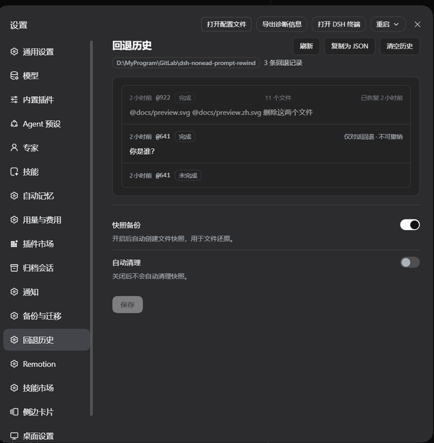

# Snapshot cleanup

Before a write-class tool edits a file, the plugin backs up the original content so a
rewind can restore the workspace too. Those backups are **snapshots**: grouped per user
message and stored per session. `/snapshot-auto-cleanup` manages them — reclaim disk space
from finished sessions, or clear the current session so it starts recording fresh.

Cleanup only removes snapshot directories. It never touches the conversation log, never
rewrites rewind history, and never removes an active session's snapshots.

## Defaults

| Setting | Default | Meaning |
| --- | --- | --- |
| `autoCleanupEnabled` | `true` | Automatic cleanup runs on a fresh install; turn it off to keep every snapshot until you run a manual sweep. |
| `autoCleanupMaxAgeDays` | `3` | A finished session whose newest snapshot is older than this many idle days becomes eligible for removal. Positive integers only; an invalid value can never steer the sweep into deleting everything. |

The cutoff is idle time, not session age: the sweep compares "now" with the newest member
stamp in each session directory, so a session still receiving writes is never eligible.

## Where the settings live

Both fields are this plugin entry's own live configuration — declared `.volatile()` in the
`Config` schema in [`src/index.ts`](../src/index.ts). Edit them on the **Plugins** page, or
with the command below; the next check or run reads the current value without a restart.



## Command

```
/snapshot-auto-cleanup                        show the current status (`status` is accepted too)
/snapshot-auto-cleanup on|off                 enable / disable the automatic sweep
/snapshot-auto-cleanup max-age <days>         set the idle cutoff in days
/snapshot-auto-cleanup run                    dry-run preview of the age-based sweep
/snapshot-auto-cleanup run --apply            execute the age-based sweep
/snapshot-auto-cleanup run --current          dry-run preview of clearing this session
/snapshot-auto-cleanup run --current --apply  clear this session's snapshots
```

Anything else — an unknown subcommand, an unknown `run` flag, a non-positive day count, or
the retired `run-apply` abbreviation — is rejected with the usage text and changes nothing.
`run` does not require `autoCleanupEnabled`: a manual sweep reads only the cutoff.

## Dry-run and `--apply`

`--apply` is the only execute switch, and it is position-independent. Without it, `run` is
a preview that reports the sessions and bytes that would be removed plus how many are kept
or skipped, and touches neither disk nor in-memory state. A real `run --apply` also
re-anchors the automatic window, so enabling automatic cleanup does not immediately repeat
the sweep you just ran.

## `run --current`

`--current` re-targets `run` from the age-based policy to the **active** session — the
"clear this session now" path. Without `--apply` it is a pure read. With `--apply` the
plugin first makes sure the session is idle: a running turn is cancelled and awaited, and
if it cannot be stopped the command errors and nothing is cleared. It then removes the
session's whole snapshot directory and forgets its in-memory tracking, so the session
starts recording fresh from its current state.

This is one-way for that session's file-rewind history: earlier code states can no longer be
restored. The conversation is untouched, and rewind-history records are kept — they simply
cannot restore files whose snapshots are gone.

## Active-session protection

Automatic cleanup and `run` always pass the current session as `keepActiveId`: it is counted
as skipped (reported as `(N active session(s) skipped.)`) and never removed, even when older
than the cutoff. Other live sessions protect themselves through their own write activity.

## State file and throttling

When enabled, the automatic sweep runs in the background after the **first session activity
of a mount** (a user message or a tool result): one check per mount, at most once per
`autoSweepIntervalMs` (default 24 hours; `AUTO_SWEEP_INTERVAL_MS` in
[`src/snapshot-cleanup.ts`](../src/snapshot-cleanup.ts)). The last-sweep time is persisted
atomically to `<dsh home>/snapshot-cleanup-last-sweep.json` as `{"lastSweepAt": <epoch ms>}`,
so a host restart cannot make the sweep run early; a missing or corrupt file reads as
"never swept" (`0`), which is safe because the sweep is idempotent and protects the active
session. `<dsh home>` is `dshHome`, else `$DSH_HOME`, else `~/.dsh`.

## Relationship with other directories

| Path | What it is | Cleanup behavior |
| --- | --- | --- |
| `<dsh home>/rewind-snapshots/` (or `snapshotDir`) | One subdirectory per session: before-write backups, staged captures, rescue copies, restore journals. | The only thing cleanup removes — whole session directories at a time. |
| `<dsh home>/rewind-history/` | The rewind audit trail, partitioned per workspace. | Never touched. |
| DSH session logs | The conversation itself. | Never touched. |
| `<dsh home>/snapshot-cleanup-last-sweep.json` | The throttle clock. | Read and rewritten by cleanup; not a snapshot. |

The policy itself is not a file: it lives in the entry's configuration, and the legacy
`snapshot-cleanup.json` is not read or written.

## Failures and read-only settings

- Automatic cleanup never rejects and never blocks the activity that triggered it: an
  invalid policy skips the sweep and logs a warning, and a sweep failure is logged.
- If the mount is aborted (the plugin unloads) before deletion or before the clock is
  re-anchored, nothing is deleted and nothing is written.
- An unreadable policy fail-closes: `status` and `run` report
  `Snapshot cleanup config invalid: ... Nothing was executed` and delete nothing.
- `on|off|max-age` report a save failure when the configuration cannot be written, so a
  read-only settings store leaves the previous policy in place.
- Without a Loader (nowhere to persist the entry's config) the policy is unavailable and
  status/run fail closed.
- A read-only snapshot directory makes a real sweep report `Cleanup failed: ...`; sessions
  are removed one at a time, so already-removed ones stay removed. A dry run still works,
  because it only reads.
