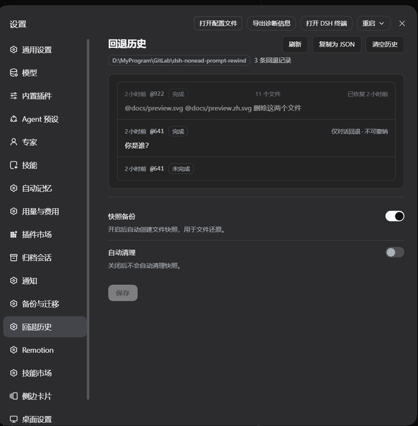

# 快照清理

每次写类工具修改文件前，插件会先备份原内容，让回退能一并还原工作区。这些备份叫**快照**，按用户消息分组、按会话存放。`/snapshot-auto-cleanup` 管理它们：回收已结束会话占用的磁盘，或清空当前会话让它从"现在"重新记录。

清理只删除快照目录——**绝不**触碰对话日志，**绝不**改写回退历史，也**绝不**删除活动会话的快照。

## 默认值

| 配置项 | 默认值 | 含义 |
| --- | --- | --- |
| `autoCleanupEnabled` | `true` | 新装即开启自动清理；关掉后在你重新开启或手动执行之前，所有快照都保留。 |
| `autoCleanupMaxAgeDays` | `3` | 某个已结束会话的最新快照超过这么多天未变动后，才会被纳入清理范围。只接受正整数；非法值永远不会导致"删掉一切"。 |

阈值看的是**失活时间**，不是会话年龄：清理会把"现在"与每个会话目录内最新的成员时间戳比较，因此仍在写入的会话时间戳持续前移，永远不会满足条件。

## 设置在哪里

这两项都是本插件条目自身的实时配置（`src/index.ts` 的 `Config` 模式中以 `.volatile()` 声明）。可在**插件**页本插件的配置卡片里改，也可用下面的命令。值即时生效：下一次自动检查或手动执行直接读取当前值，无需重启宿主。



## 命令

```
/snapshot-auto-cleanup                        查看当前状态（`status` 亦可）
/snapshot-auto-cleanup on|off                 开启 / 关闭自动清理
/snapshot-auto-cleanup max-age <天数>         设置失活阈值（天）
/snapshot-auto-cleanup run                    预演按失活阈值的清理
/snapshot-auto-cleanup run --apply            真正执行按阈值的清理
/snapshot-auto-cleanup run --current          预演清空本会话快照
/snapshot-auto-cleanup run --current --apply  真正清空本会话快照
```

其他输入——未知子命令、未知 `run` 选项、非正的天数，以及已移除的 `run-apply` 缩写——都会返回用法说明且不做任何改动。`run` 不要求先开启 `autoCleanupEnabled`：手动清理只读取阈值。

## 预演与 `--apply`

`--apply` 是唯一的执行开关，且位置无关。不加它时 `run` 只是预演：报告将要删除的会话数与字节数、保留与跳过的数量，磁盘与内存都不改动。真正执行会同时重锚自动清理的时间窗，因此开启自动清理后不会紧接着重复刚跑过的那次清理。

## `run --current`

`--current` 把 `run` 从按阈值策略改为针对**当前活动**会话，即"立刻清空本会话"。不加 `--apply` 是纯读取；加 `--apply` 时插件先确保会话空闲——有正在运行的回合会先取消并等待结束，若无法停止则报错且不清空——然后删除该会话的整个快照目录并清除内存里的追踪状态，让会话从当前状态重新记录。

对该会话的文件回退历史来说这是单向的：更早的代码状态无法再还原。对话保持完整；回退历史记录也不会被删除，只是无法再还原那些快照已不存在的文件。

## 活动会话保护

自动清理与 `run` 始终把当前会话作为 `keepActiveId` 传入：它会被计入跳过数（输出 `（跳过了 N 个活动会话。）`），即使最新时间戳早于阈值也绝不删除。其他仍在运行的会话靠自身活动自保——任何写入都会前移其最新时间戳。

## 状态文件与节流

开启后，自动清理在**一次挂载的首次会话活动**（一条用户消息或一个工具结果）之后于后台运行：每次挂载只检查一次，且距上次清理至少 `autoSweepIntervalMs`（默认 24 小时；常量 `AUTO_SWEEP_INTERVAL_MS` 在 `src/snapshot-cleanup.ts`）。上次清理时间持久化在 `<dsh home>/snapshot-cleanup-last-sweep.json`，内容为 `{"lastSweepAt": <epoch ms>}`，原子写入（临时文件 + 改名），所以重启宿主不会让它提前运行。文件缺失或损坏按"从未清理"（`0`）处理，这是安全的：清理幂等且保护活动会话。`<dsh home>` 取插件配置 `dshHome`，否则 `$DSH_HOME`，再否则 `~/.dsh`。

## 与其他目录的关系

| 路径 | 是什么 | 清理行为 |
| --- | --- | --- |
| `<dsh home>/rewind-snapshots/`（或 `snapshotDir`） | 每个会话一个子目录：写前备份、暂存副本、救援副本、还原日志。 | 清理唯一会删除的东西，按整个会话目录删除。 |
| `<dsh home>/rewind-history/` | 回退审计记录，按工作区分区。 | 从不触碰。 |
| DSH 会话日志 | 对话本身。 | 从不触碰。 |
| `<dsh home>/snapshot-cleanup-last-sweep.json` | 节流时钟。 | 被清理读写；它不是快照。 |

清理策略本身不再是文件：它保存在插件条目的配置里，旧版 `snapshot-cleanup.json` 既不被读取也不被写入。

## 失败与只读设置下的表现

- 自动清理从不抛出、也不阻塞触发它的活动：策略无效时跳过并记警告，清理失败也记日志。
- 若挂载在删除前或重锚时钟前被中止（插件卸载），既不删除也不写入。
- 策略读不出时按失败关闭处理：`status` 与 `run` 报 `快照清理配置无效：…未执行任何操作`，不删任何东西。
- 配置无法写入时，`on|off|max-age` 报保存失败；因此设置存储只读时，原有策略保持不变。
- 没有 Loader（无处持久化条目配置）时策略不可用，状态与执行都失败关闭。
- 快照目录只读时，真正执行会报 `清理失败：…`；会话是逐个删除的，已删除的不会回滚。预演仍然可用，因为它只读。
